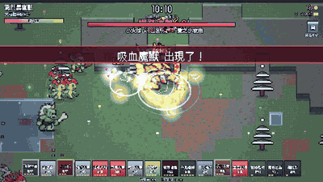
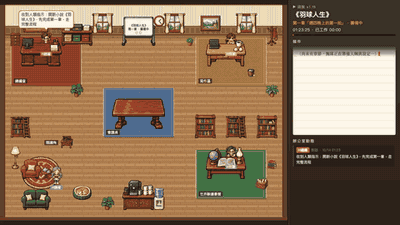
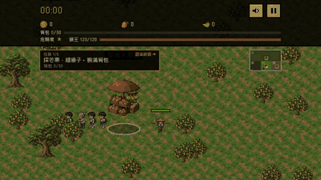
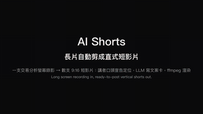
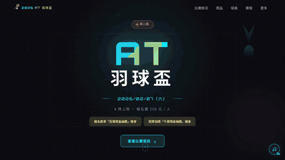
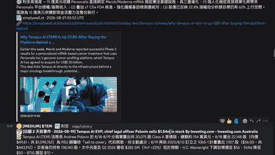

# Highlights

Source for the animated grid on my [profile](README.md). Each tile is a 400x225 GIF in `assets/highlights/`;
after changing a tile, rebuild the combined GIF with `uv run scripts/build_highlights.py`.

<table>
<tr>
<td width="50%" valign="top"> <b>Digimon Survivor</b> Survivors-style fan game with anime evolutions and 100 AI-drawn characters</td>
<td width="50%" valign="top"> <a href="https://github.com/marshal604/ai-novel-studio"><b>AI Novel Studio</b></a> Four AI agents write a novel together, replayed as a pixel-art office</td>
</tr>
<tr>
<td width="50%" valign="top"> <a href="https://github.com/marshal604/mango-orchard-defense"><b>Mango Orchard Defense</b></a> Original pixel-art game in a Taiwanese mango orchard</td>
<td width="50%" valign="top"> <a href="https://github.com/marshal604/ai-shorts"><b>AI Shorts</b></a> One long recording in, ready-to-post vertical shorts out</td>
</tr>
<tr>
<td width="50%" valign="top"> <a href="https://github.com/marshal604/at-badminton-landing"><b>AT Badminton Cup</b></a> Promo and live-scoring site for my badminton club's tournament</td>
<td width="50%" valign="top"> <a href="https://github.com/marshal604/stock-news-radar"><b>stock-news-radar</b></a> LLM news alerts that are cross-checked before they are posted</td>
</tr>
</table>
