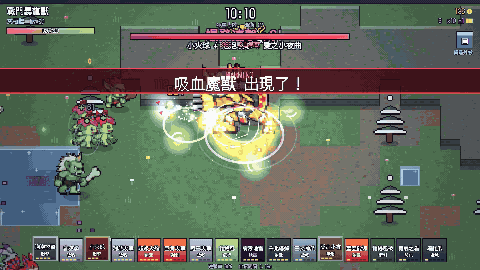
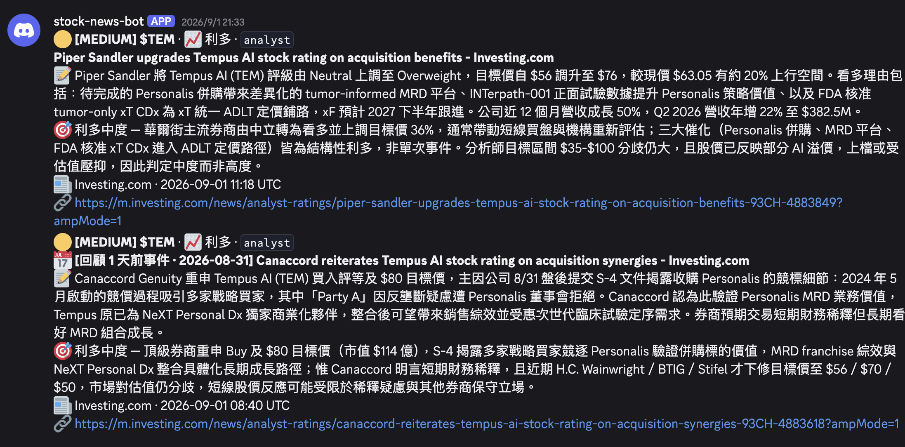

# Hi, I'm Hubert Yang 👋

**Senior Software Engineer · Taipei, Taiwan** — 9+ years building web products, from real-time video (WebRTC)
and payments to performance and observability. These days I build games and tools **together with AI agents**
(Claude Code, Codex) and write down what works.

**English** · [繁體中文](#繁體中文)

---

## 🤖 AI-built projects

### 🥭 Mango Orchard Defense · [repo](https://github.com/marshal604/mango-orchard-defense)

A top-down pixel-art web game set in a Taiwanese mango orchard: harvest mangoes, chase off thieving Formosan
macaques, sell at a roadside stand, hire workers and defeat the Monkey King. Original game; characters are
AI-generated sprite sheets cut and aligned by a custom pipeline.
`Vite` `React` `Phaser` `TypeScript` · ▶ [gameplay video](https://github.com/marshal604/mango-orchard-defense/blob/main/docs/media/gameplay.mp4)

### 🦖 Digimon Survivor (fan project, private)

Reverse-engineered a Survivor.io-style web game's shipped bundle (spawner curves, enemy tiers, upgrade tables),
then rebuilt it as a Digimon fan game with my own redesigns: a random move pool with combos instead of a single
active slot, branching 1999-anime evolution lines with cutscenes, canonical attacks, and an AI pixel-art pipeline
(walk / attack / idle sheets for 100 characters). Recorded with a frame-stepped 60 fps demo director.
`TypeScript` `Canvas` `Codex image gen` `Playwright` `ffmpeg` · code is private because of the Digimon IP.

### 📰 stock-news-radar · [repo](https://github.com/marshal604/stock-news-radar)

An LLM news radar built to **not hallucinate**: multi-source polling (SEC EDGAR, Finviz, Google News), a primary
model cross-checked by a different auditor model, verbatim-quote oracles, keyword-vs-LLM differential checks,
numeric guardrails and a golden-set regression suite, posting tiered alerts with Chinese summaries to Discord.
`Python` `Claude` `GitHub Actions` · 129 tests

## 🧰 Open source & earlier work

- [**asana-style-extension**](https://github.com/marshal604/asana-style-extension) — Chrome extension for Asana, still in use · [Chrome Web Store](https://chromewebstore.google.com/detail/asana-helper/plhefljdadpkcldpmlaihiaeolncaghj)
- [**react-game-dialogue**](https://github.com/marshal604/react-game-dialogue) — dialogue-system UI kit for React
- [**resume-generator**](https://github.com/marshal604/resume-generator) — the resume template generator I used early in my career
- [**blog**](https://github.com/marshal604/blog) / [blog.hubertyang.com](https://blog.hubertyang.com/) — writing practice on frontend and engineering

## 💼 Experience

| Role | Company | Period |
|---|---|---|
| Sr. Software Engineer | AmazingTalker | 2021 – 2026 |
| Frontend Engineer | ViewSonic | 2020 – 2021 |
| Software Engineer | Genie Network | 2018 – 2020 |
| Software Engineer | SunNet Tech | 2016 – 2018 |

Selected impact at AmazingTalker:

- Built an internal **AI-assisted debugging workflow** (codebase context + user logs + product metrics) that cut recurring frontend/RTC bug analysis from hours to minutes
- Unified TRTC and Amazon Chime into one **RTC adapter layer**, simplifying BytePlus and later Electron support
- **TTFB −70%** (400 ms → 120 ms) on a Lambda@Edge caching flow; **CI/CD −62%** (18 → 7 min); **bundle −25%**
- Moved **350 TB** of recordings to S3 with an SQS-based Node.js workflow; observability with OpenTelemetry/Grafana and New Relic
- Consolidated 30+ payment components (Stripe, PayPal, TapPay, Alipay, dLocal …) into 5 reusable modules
- Regular tech talks to 30+ engineers on WebRTC, micro-frontends, XSS prevention and GraphQL caching

**Stack:** TypeScript · React · Vue · Angular · Node.js · Electron · WebRTC · AWS · GraphQL · Phaser · Python

---

## 繁體中文

**資深軟體工程師 · 台北** — 9 年以上 Web 產品經驗，做過即時影音（WebRTC）、金流、效能優化與可觀測性。
最近專注在 **和 AI agent 一起開發**（Claude Code、Codex），用它做遊戲和工具，並把有效的做法整理下來。

**AI 作品**

- 🥭 **[芒果園保衛戰](https://github.com/marshal604/mango-orchard-defense)**：台灣芒果園主題的像素風網頁遊戲，採芒果、趕獼猴、擺攤、打倒猴王。原創遊戲，角色是 AI 生成的 sprite sheet，經自製產線切格對齊。
- 🦖 **數碼倖存者（同人作品，私人 repo）**：逆向分析一款 Survivor.io 類網頁遊戲的程式包，再重做成數碼寶貝同人遊戲，並加入自己的改進：隨機招式池與連擊、1999 年動畫的分支進化與演出、原作招式、100 隻角色的 AI 像素圖產線。
- 📰 **[stock-news-radar](https://github.com/marshal604/stock-news-radar)**：設計成「不會亂講話」的 LLM 新聞雷達：雙模型交叉驗證、引用必須逐字對得上原文、關鍵字與 LLM 雙路比對、數字防呆與回歸測試集，分級推送中文摘要到 Discord。

**經歷**：AmazingTalker 資深軟體工程師（2021–2026）· ViewSonic 前端工程師 · Genie Network 軟體工程師 · SunNet Tech 軟體工程師。
**學歷**：國立高雄第一科技大學 電腦與通訊工程系（2011–2015）
